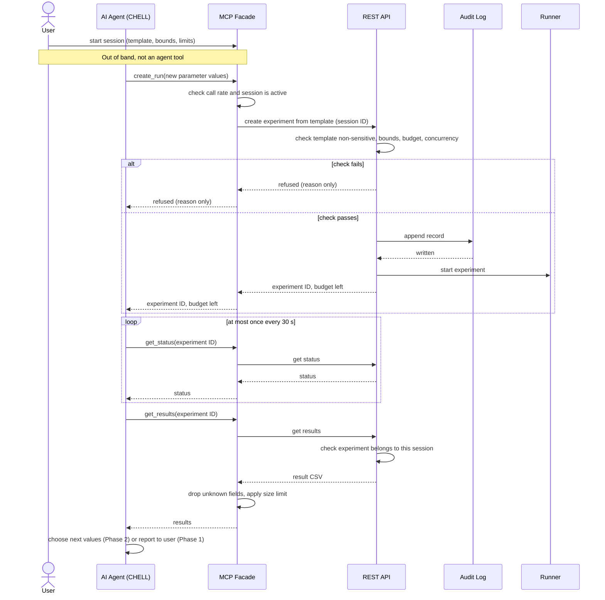

# Proposal: Adding an Auto Mode to the Agentic Plan

## 1. Summary
The current [Agentic Implementation Plan](agentic_plan.md) was written last year under the assumption that the AI agent should be trusted as little as possible. Every result is kept away from the agent, and the user has to manually release data before the agent can see it. Following client feedback that this is too strict given how far AI agents have come, we propose splitting agent behavior into two modes:

- **Manual mode**: the current plan, essentially unchanged.
- **Auto mode**: inside a time-limited, budget-limited session the user opens, the agent can run experiments and read their results without asking each time. Only non-sensitive experiments can be used.

This document explains what we keep from the original plan, what we change or remove and why, and how auto mode would work. The longer-term goal the client described, where the agent tries inputs, looks at the results, and tunes the inputs on its own, is covered as a second phase (Section 6), since it builds on auto mode but adds its own problems.

## 2. Why the Original Plan Is Strict
The original plan treats the agent and its LLM provider as untrusted (the "CHELL"). Two rules follow from that:

- **S-1 / S-2:** the agent never sees experiment results or artifacts. Sensitive results are written to a local "handoff region" instead of being returned to the agent.
- **Consent gesture (§4.3, §5.7):** the user must take an explicit action (copy/paste, moving a file, etc.) to release each result to the agent. §5.7 says friction here is deliberate and that requests to make consent easier should be treated with skepticism.

Most of the human-in-the-loop cost in the plan comes from these two rules. In contrast, the plan asks for very little approval on *actions*: submitting an experiment only needs an audit record (S-8).

This matters for the client's goal. **An agent that cannot see results cannot tune inputs.** As written, the plan makes the "try, observe, adjust" loop impossible without a human copying results back to the agent after every run.

## 3. What We Keep
Most of the original plan does not create friction for the user and still makes sense. We propose keeping all of the following in both modes.

| Item | Section | Why we keep it |
|---|---|---|
| Local MCP facade calling the existing REST API | §4.1, §4.3, §6.1 | The architecture decision is unrelated to strictness. It reuses the CLI's auth and the existing endpoints. |
| GitHub token introspection for auth | §4.1, §6.2 | Same as above. No reason to revisit. |
| Functional invariants I-1, I-2, I-3 | §3.1 | These are about correctness (one call per tool call, no altered arguments, no made-up response data), not about restricting the agent. |
| S-3 Credential confinement | §3.2 | The agent never needs the token. Keeping it hidden costs the user nothing. |
| S-4 Bounded tool surface (static allowlist) | §3.2, §5.3 | More important in auto mode. With no human approving each call, the fixed set of tools is the main limit on what the agent can do. |
| S-5 Diagnostic discipline, S-6 Egress confinement | §3.2 | No user friction, and they protect the token and data from leaking through logs or network calls. |
| S-8 Audit integrity, health check, degraded mode | §3.2, §4.2 | More important in auto mode. When nobody approves actions as they happen, the audit log is how the user finds out afterward what the agent did. |
| Fail closed, CI checks, refusal tests, SDK telemetry caution | §5.4, §5.5, §5.6, §5.8, §5.9 | Good engineering practices that apply to either mode. |
| Localhost-only binding for the facade | §7 Gaps | More important in auto mode, since a spoofed caller would also get auto-mode permissions. |
| The HIGH-sensitivity handoff path | §4.3 | Kept as the behavior for manual mode, which is the only mode sensitive experiments can use. |

## 4. What We Change or Remove

| Item | Current | Proposed | Why |
|---|---|---|---|
| **S-1 Result confidentiality** | Absolute: the agent never sees results. | Applies to every experiment in manual mode. Sensitive experiments can't enter auto mode at all (5.1). Inside an auto session, the agent sees the results of the experiments it creates. | The tuning loop requires the agent to read results. Many experiments (addNums, class projects, benchmarks) have no confidentiality requirement. |
| **S-2 Artifact confidentiality** | Absolute. | Same condition as S-1, plus a size cap on anything returned to the agent. | Same reason. The size cap keeps large artifacts from flooding the agent's context. |
| **Per-result consent gesture** | Required for every HIGH result. | Not needed in auto mode, since only non-sensitive experiments enter it. Kept for manual mode. | This is the main source of friction the client objected to. |
| **§5.7 "The user is a cooperator, not an obstacle"** | Treat requests to ease consent with skepticism. | Rewrite: friction is still the right choice for sensitive data, but the user decides what is sensitive, per experiment. | The client has made this decision explicitly, and it should be recorded in the plan rather than left in conflict with it. |
| **§5.2 Default new operations to HIGH** | Per tool. | Keep, and add a per-experiment sensitivity classification that also defaults to sensitive (5.1). | Keeps the safe default. Marking an experiment non-sensitive is a one-time choice by the user, not a step for every result. |
| **Local log `user_approval` field** | Yes/no. | Replace with `mode` and `approved_by` (`user` or `auto`). | So the log can tell a user-approved action apart from one auto mode did on its own. |
| **Scope: agent quality out of scope** | §2 | Still true for the model's choices, but loop limits (budgets, stopping rules) come into scope. | Once the agent can act repeatedly without a human, limiting how much it can do becomes an infrastructure concern. |

Nothing is deleted outright. The strict path becomes manual mode, which remains the only option for sensitive experiments.

## 5. Auto Mode Design
Auto mode is not a global switch. It exists only inside an **auto session**: a time-limited, budget-limited window the user opens around one template experiment. Outside a session, the agent is in manual mode and the original plan applies unchanged.

### 5.1 Sensitive vs. Non-Sensitive Experiments
**Definition.** An experiment is **sensitive** if any part of it (code, input data, configuration, or results) must not be shared with a third-party AI provider. It is **non-sensitive** if its owner is comfortable with all of it being sent to the agent's LLM provider.

An experiment is sensitive if it meets **any** of these:

1. **Personal data:** it uses or produces data about identifiable people (student records under FERPA, health data, human-subjects research under IRB, survey responses).
2. **Restricted data:** its data comes with a license, data use agreement, or NDA that limits who may see it.
3. **Confidential work:** its code or results are unpublished, or belong to a sponsor or collaborator who has not agreed to sharing.
4. **Secrets:** its code or config files contain credentials, API keys, or internal hostnames.

Everything else is non-sensitive: synthetic data, public datasets, public benchmarks, and course or demo experiments.

| Example | Classification | Reason |
|---|---|---|
| addNums (`example_experiments/python/addNums.py`) | Non-sensitive | Synthetic inputs and outputs |
| Genetic algorithm tuned on a standard benchmark function | Non-sensitive | No real-world data |
| Classifier trained on a public dataset (e.g., UCI Iris) | Non-sensitive | Data is already public |
| Model trained on student grades or enrollment records | Sensitive | Personal data (FERPA) |
| Simulation using a sponsor's proprietary model or data | Sensitive | Restricted data, confidential work |
| Results a research group has not published yet | Sensitive | Confidential work |
| Any experiment whose script contains an API key | Sensitive | Secrets |

**Rules:**

- The experiment owner sets the classification. GLADOS cannot verify it, so it is the owner's statement, and it is recorded in the audit log.
- Every experiment is **sensitive by default** (following §5.2 of the original plan). The owner has to mark it non-sensitive.
- **Only non-sensitive experiments can be used in auto mode.** Sensitive experiments stay in manual mode, where S-1, S-2 and the consent gesture from the original plan still apply.
- The agent cannot change any experiment's classification.

This is the main change from the first draft of this proposal. Sensitivity no longer hides some results *inside* auto mode. Instead it decides which experiments can enter auto mode at all, and inside a session the agent can see every result it produces.

### 5.2 What the Agent Can and Cannot Do

| The agent CAN | The agent CANNOT |
|---|---|
| Read the configuration of the session's template experiment (parameters, ranges, description) | See or act on any experiment outside its current session, including the user's other experiments and other users' |
| Create new experiments from the template, changing only hyperparameter values within the session's bounds | Upload, edit, or replace experiment code, or change which files an experiment reads or writes |
| Start the experiments it created, within the session limits | Modify the template experiment itself |
| Check the status of its session's experiments | Delete experiments or results, including its own |
| Read the results of its session's experiments (result CSV, pass/fail counts, short error summaries) | Start, extend, or end a session, or change its limits or parameter bounds |
| Cancel its session's experiments | Change any experiment's sensitivity classification |
| See how much of the session's budget is left | Use a sensitive experiment as a template |
| | Set `workers` or `timeout` above the session caps |
| | Access the token, read files by path or URL, or reach anything other than the GLADOS REST API (S-3, S-4, S-6) |
| | Take any auto-mode action after the session ends (it falls back to manual mode) |

### 5.3 Auto Sessions
**Starting a session.** The user starts a session outside the agent, for example with a CLI command. There is no MCP tool for it. When starting, the user chooses:

- **Template:** one of their own non-sensitive experiments. The agent's experiments are copies of it with different parameter values.
- **Parameter bounds:** which hyperparameters the agent may change, and the allowed range for each.
- **Limits:** the values in 5.4. If the user doesn't set them, the defaults apply.

**Session boundary.** The server tags every experiment the agent creates with the session ID and checks that tag on every request. Because the check happens on the server and not only in the local facade, the boundary still holds if the facade restarts. Each experiment belongs to exactly one session, and the agent can only see experiments from its current session.

**Ending a session.** A session ends at the first of:

- the user ends it,
- the time limit runs out,
- the experiment or trial budget runs out, or
- the audit log becomes unavailable (degraded mode, original plan S-8).

When a session ends, the agent loses auto-mode access immediately. Queued experiments are cancelled, and running experiments finish normally. If the user ends the session with a "stop all" option, running experiments are cancelled too. Everything created in the session stays in the user's account like any other experiment.

### 5.4 Session Limits
These are proposed starting values. They need client input (Section 9).

| Limit | Proposed default | Enforced by | Reason |
|---|---|---|---|
| Session length | 4 hours | Server | No session runs unattended indefinitely |
| Experiments created per session | 10 | Server | Caps the number of rounds |
| Total trials per session (sum over all experiments) | 500 | Server | One experiment can expand into many trials through parameter ranges |
| Experiments running at once | 2 | Server | Leaves cluster capacity for other users |
| `workers` per experiment | No more than the template's value | Server | The agent can't claim more parallelism than the user chose |
| `timeout` per trial | No more than the template's value | Server | Same reason |
| Tool calls | 30 per minute, 1,000 per session | Facade | Stops a runaway agent and protects the GitHub 5,000 requests/hour limit |
| Status checks | At most once every 30 seconds per experiment | Facade | Polling is the most likely source of excess calls |
| Result size returned to the agent | 64 KB per call | Facade | Keeps responses predictable. Larger results are cut off, with a note saying so |

When a limit is reached, the request is refused with a short reason, such as "trial budget exhausted." Following the fail-closed rule (original plan §5.5), it is never partly carried out.

The agent's own LLM token use happens on the agent's side, where GLADOS can't see or limit it. The tool-call limit is the closest control GLADOS has.

### 5.5 Security Carried Over from the Original Plan

| Original rule | In auto mode |
|---|---|
| S-1, S-2: the agent never sees results or artifacts | Replaced by the admission rule in 5.1: sensitive experiments never enter auto mode. Still applies in full to manual mode. |
| S-3: credential confinement | Unchanged |
| S-4: fixed tool list, no free-form paths or URLs | Unchanged, and extended: parameter values must fall within the session bounds |
| S-5, S-6: logs and network restrictions | Unchanged |
| S-8: audit integrity | Unchanged. No session action completes without an audit record. |
| I-3: responses carry nothing the REST API didn't return | Unchanged. The size limit only cuts results off, and says so. |
| Fail closed, localhost-only facade | Unchanged |

### 5.6 One Auto Mode Iteration
GitHub token checks happen on every REST call, as in the original plan §4.1. They're left out of the diagram for readability.

### 5.7 Audit and Invariant Changes
**Audit records** gain `session_id`, `mode`, `approved_by` (`user` or `auto`), and `template_experiment_id`. Session start and end are also logged, with the bounds and limits chosen and the reason the session ended.

**Invariants:**

- **S-1, S-2:** apply to all experiments in manual mode. In auto mode they are replaced by S-9.
- **S-9 Admission:** only experiments the owner marked non-sensitive can be session templates, and every experiment created in a session inherits that classification.
- **S-10 Session boundary:** the agent can only read or act on experiments tagged with its current, active session.
- **S-11 Limits:** no action that would exceed a session limit is carried out.
- **S-12 User control:** sessions, bounds, limits, and classifications are set only by the user, never through an agent tool.

Each one can be tested in CI the same way as original plan §5.6, by attempting every CANNOT action in 5.2 and checking that it is refused.

## 6. Phase Scope

### 6.1 Phase 1: Auto Mode Infrastructure and Permissions
**Goal:** the agent can run experiments and read results inside a session, one step at a time as the user prompts it (for example, "try x from 1 to 20 and tell me what you see").

**In scope:**

- Sensitivity classification on experiments, defaulting to sensitive
- Starting and ending sessions, with session tagging and server-side checks
- The session limits in 5.4
- MCP tools for each action in the CAN column of 5.2
- The audit and invariant changes in 5.7
- Tests showing every CANNOT action is refused (original plan §5.9: test refusals, not just success)

**Out of scope:** the agent deciding on its own what to run next, objectives, and stopping rules.

**Done when:** with addNums as the template, an agent can create, run, and read results for experiments in a session, and tests show every CANNOT action in 5.2 is refused.

### 6.2 Phase 2: Automatic Tuning Loop
**Goal:** the user states a goal once, and the agent runs several rounds on its own without a prompt between rounds.

**Adds:**

- **Objective:** the user names one result column to maximize or minimize when starting the session.
- **Stopping rules:** the loop stops when the target is reached, when there has been no improvement for N rounds, or when the budget runs out. The facade enforces these, since it sees every result. Trusting the agent to stop on its own would go against original plan §5.1.
- **Coarse-to-fine rounds:** GLADOS already runs every combination of a parameter's min/max/step range (`apps/runner/modules/configs.py`). So each round is one experiment: a wide grid first, then narrower ranges around the best results.
- **Round history:** each round records its parameter values, its best result, and the round it came from, so the user can see how the agent reached its answer.
- **Final report:** the best parameter values found and the round history, returned to the user when the loop stops.

**Out of scope:** multiple objectives, parameters not in the template, and changes to experiment code.

**Done when:** given a template and an objective, the agent completes at least three rounds, stops on its own by one of the stopping rules, and every round appears in the audit log.

### 6.3 Why This Split
Phase 1 is useful by itself. Even without a loop, a user can ask the agent to run a few variations and compare them. It also builds every permission the loop relies on. Phase 2 adds no new permissions: it only adds the objective, stopping rules, and round history on top of Phase 1.

## 7. Risks and Tradeoffs
- **Results reach the LLM provider.** This is accepted by design for non-sensitive experiments. Sensitive experiments can't enter auto mode.
- **Owners may misclassify experiments.** The default is sensitive, so a mistake means marking something non-sensitive on purpose. The audit log records who marked it and when.
- **Prompt injection through results.** A result file could contain text that tries to steer the agent. The fixed tool list, session boundary, limits, and the no-delete rule limit what a steered agent can do.
- **Less oversight while a session runs.** Offset by the session limits and audit records. The tradeoff is reviewing after the fact instead of approving each action.

## 8. Proposed Milestones
1. Revise the original plan's sections listed in Section 4, after this proposal is approved.
2. Build the MCP facade with manual mode as specified in the original plan.
3. Phase 1: sensitivity classification, auto sessions, session limits, and audit changes.
4. Test end to end with addNums in both modes (original plan §8.1).
5. Phase 2: the tuning loop.

## 9. Questions for the Client
1. Is the owner's own classification enough, or should non-sensitive status be confirmed by an admin or tied to something like IRB status?
2. Are the default limits in 5.4 reasonable for the cluster? Should admins be able to set per-user maximums?
3. Should the agent be able to read the template's code and `trialExtraFile` archives, or only the result CSV? Code helps it understand the parameters, but sends more to the provider.
4. When a session ends, should running experiments finish or be cancelled?
5. Should auto mode be open to all users, or only privileged/admin users at first?
6. For non-sensitive experiments, is it acceptable that the LLM provider may retain the data under its own policies?
