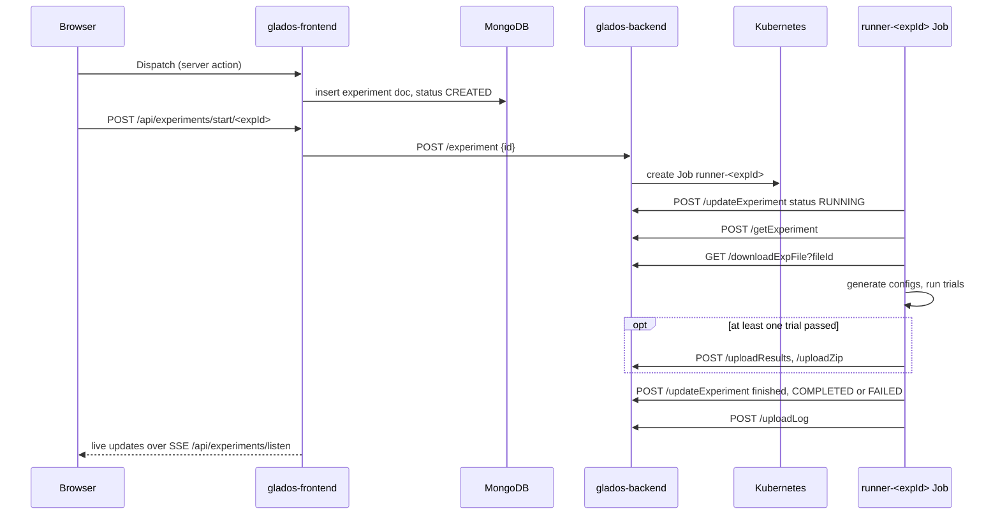

# Your First Experiment (Happy Path)

This page walks a new developer through running one experiment on a local GLADOS, watching what happens at every layer, and then breaking it on purpose. It assumes you finished [Getting Started From Zero](../developerhelp/getting_started_from_zero.md) and have <http://localhost:3000> open and signed in.

The [Usage](usage.md) page documents every field in the UI. This page is narrower: one experiment, start to finish, with the internals exposed so you know where to look when it does not work.

## What you are about to run

The "Add Nums" default experiment uses `example_experiments/python/addNums.py`. It reads two integers `x` and `y` from an INI config file, and writes a two-line CSV:

```csv
Addition,Subtraction
8,2
```

You will sweep `x` and `y` from 1 to 10. Neither parameter has a default set, so GLADOS takes the full cross product: 100 trials. Each trial runs the script once with its own generated config file. If you give a parameter a default, the sweep changes to one-factor-at-a-time around the defaults, which is far fewer trials. The [Permutations](usage.md#permutations) section explains the rule.

## Part 1: The happy path in the UI

### Step 1. Open the default experiment

A fresh account sees an empty dashboard. The "Activity" panel on the right is a hard-coded placeholder, not real data.


Click **Run a Default Experiment** in the left sidebar. A modal titled "Select Default Experiment" lists five presets. Pick **Add Nums (Python)**.


Behind the scenes the frontend downloads `addNums.py` from GitHub and uploads it to your local database for you. If you click **Next** before that finishes you will see "Still setting up... wait a couple seconds and try again." Wait and try again.

### Step 2. Walk the tabs

The form slides in from the right with six steps across the top. Every step has a **Number of Workers** box, **Cancel**, **Back**, and **Next** at the bottom.

1. **Information.** Already filled in. The important fields are `Trial Result` = `AddNumResult.csv` (the file the runner reads each trial's output from) and `Config File Format` = `ini`. Leave `Trial Result Line Number` at 0. Give the experiment your own name so you can find it later.

    

2. **Parameters.** Two integer parameters `x` and `y`, each min 1, max 10, step 1, with the "Default?" switch off. The "Expected Permutations" counter in the corner shows 100. Keep the full 10×10 run: the timings and the chart check below assume 100 trials, and it only takes a few seconds.

    

3. **User Defined Constants.** Empty. Anything you type here is appended verbatim to every generated config file, and the red disclaimer is accurate: nothing is validated. Leave it empty for now.

    

4. **Post Process.** Leave both checkboxes off. "Send Email Upon Completion" needs Gmail credentials in the secrets file. "Scatter Plot" needs two column names from your results.

    

5. **Confirmation.** The raw JSON that will be stored as the experiment document. Skim it. This is exactly what you will see in MongoDB later. Note `"default": -1` on each parameter, which is how "no default" is encoded, and `"file"`, the id of the uploaded script in GridFS.

    

6. **Dispatch.** Normally you would drop a file here. For a default experiment `addNums.py` is already marked "Selected" in the "Recent Files" table below the drop zone. Click **Dispatch**.

    

You should see the green toast "Started experiment!" and a new row in the list. The form panel briefly reopens as a blank "New Experiment" form with red required fields before closing on its own. That is a quirk, not an error.

!!! note "Number of Workers does nothing"
    The value is saved on the experiment document but the runner never reads it. All trials are launched at once regardless.

### Step 3. Watch it run

The row's status text moves through three phrases:

1. **Experiment Awaiting Start.** The document exists but no runner has picked it up. The sidebar counter "N experiments in queue" counts experiments in this state. The buttons available now are **Copy**, **Share**, and **Cancel**.

    

2. **Experiment In Progress.** The runner is up. The row shows successes, failures, and runs remaining. An **Open Live Log** button appears and polls the runner pod's output every five seconds.
3. **Experiment Completed.** The row shows fails, successes, timestamps, total time, and average time per run. If no trial succeeded, the row says **Experiment Failed** instead. [Part 3](#experiment-3-every-trial-fails) shows what that looks like.

    

Timing from a real local run of this experiment on a laptop, measured on 2026-09-20:

| Phase | Time |
|-------|------|
| Awaiting Start (runner pod pulling image and starting) | about 50 s the first time, a few seconds after that |
| Running 100 trials | 3.55 s |
| Runner Job and pod deleted after finishing | about 60 s later |

"Awaiting Start" is long on the first run because the runner container has to be created. If it sits there for several minutes, something failed silently. Jump to [Part 3](#part-3-when-it-goes-wrong).

### Step 4. Look at the results

Expand the row. The buttons that appear once an experiment is finished:

- **Download Results** gives `results.csv`. One row per trial with the `Addition` and `Subtraction` columns from the script plus the `x` and `y` values that produced them.
- **Download Project Zip** gives every trial's config file and log, plus any extra file you asked for.
- **See Graph** opens the chart modal on `results.csv`. All series start hidden, so the chart is empty at first. Pick `x` as the X-Axis Column, then click the **Addition** legend entry to show it. Changing the x-axis hides every series again, so pick the axis first. Tick "Aggregate data?" with mode `sum` and you get a straight line from 65 to 155, which is the sum over all ten `y` values of `x + y`, or `10x + 55`. That is a quick sanity check that the results are real.

    

    
- **View System Log** opens the runner's own log for the whole experiment.
- **Copy Experiment** reopens the form prefilled so you can change parameters and rerun.
- **Share Experiment** copies a link. Anyone signed in who opens it gets read access.
- **Archive Experiment** and **Delete Experiment**. Archiving hides the row immediately and the header changes to "Projects (0 of 1)". Open the **Filter** menu and switch on "Include Archived" to see it again with an **Unarchive Experiment** button.

    

    

That is the whole user-facing loop. Now look underneath it.

## Part 2: What just happened, layer by layer

Keep a container terminal open next to the browser and repeat the run. The sequence is the same for every experiment.



### 2.1 The frontend writes the document

Clicking Dispatch calls a Next.js server action that inserts the form JSON into the `experiments` collection of the `gladosdb` database with `status: "CREATED"`, `finished: false`, and your user id as `creator`. The uploaded file was already stored in the GridFS bucket `fileBucket` when you picked it, and the document only holds its id.

The dashboard does not poll. It holds a server-sent events connection to `/api/experiments/listen` that pushes every experiment you created or that was shared with you. That is why rows update without a refresh.

### 2.2 The frontend asks the backend to start it

The frontend then posts to its own route `/api/experiments/start/<expId>`, which forwards to the backend inside the cluster at `http://glados-service-backend:5050/experiment`. The backend returns 200 immediately and creates the Kubernetes Job in the background.

Watch it appear:

```bash
kubectl get jobs
kubectl get pods
```

You will see a job and a pod both named `runner-<expId>`. The pod uses the `runner` image that Tilt built from `apps/runner`. The whole Job (and its pod) is deleted automatically about 60 seconds after it finishes (`ttlSecondsAfterFinished: 60` in `apps/backend/job-runner.yaml`). After that, `kubectl get jobs` no longer lists it and `kubectl logs job/runner-<expId>` fails, so look quickly or read the uploaded log instead.

### 2.3 The runner does all the work

Everything below happens inside that pod. Follow along with:

```bash
kubectl logs -f job/runner-<expId>
```

1. Sets the experiment `status` to `RUNNING`. Note that the runner never touches MongoDB directly. Every read and write goes through the backend's HTTP API. You can see this from the other side with `kubectl logs deploy/glados-backend`, which fills with `POST /updateExperiment` lines while a runner is active.
2. Fetches the experiment document and downloads the executable into `ExperimentFiles/<expId>/`.
3. Detects the file type with libmagic. Python, JAR, ELF binary, and zip are the supported kinds. A zip is unpacked and the `Executable File` field says what to run inside it.
4. For Python files, runs `pipreqs` to guess dependencies and `pip install`s them, unless you shipped a `userProvidedFileReqs.txt` in a zip. The log shows `Generated pip requirements` at this point.
5. Generates one config file per permutation into `configFiles/0.ini`, `1.ini`, and so on. Your User Defined Constants text is the template and `{x}` style placeholders are substituted. The log line `Generated 100 configs` confirms the count.

A real runner log for this experiment looks like this, trimmed:

```text
INFO | glados | GLADOS Runner Started
INFO | glados.experiment | Downloading file for 6ab0413b1d02668b76465656
INFO | glados.experiment | Raw Filetype: Python script, ASCII text executable, Filtered Filetype: python
INFO | glados.experiment | Generated pip requirements
INFO | glados.experiment | param x varies, adding to batch
INFO | glados.experiment | param y varies, adding to batch
INFO | glados.experiment | Generated 100 configs
INFO | glados.experiment | Now Running 100 trials
INFO | glados.experiment | Running Trial 0
INFO | glados.experiment | Wrote config0 to a file
INFO | glados.experiment | Running Trial 2
...
```

6. Launches every trial at once in a process pool. Trial `n` runs in its own folder `trial<n>` as `python ../addNums.py ../configFiles/<n>.ini`, with the timeout from the form. Standard output and error go to `ResCsvs/log<n>.txt`.
7. Each trial reads line `Trial Result Line Number` of `trial<n>/AddNumResult.csv` and hands it back to the main runner process. That process is the only one that counts: it bumps `passes` or `fails` in the database as each trial finishes, which is what moves the counters in the UI. A trial that errors or times out is logged with its error and counted as a fail, and the other trials keep running.
8. Once every trial is done, writes `results.csv` sorted by trial number: one row per trial with its outputs and parameter values. Failed trials get a row too, with `ERROR` or `TIMEOUT` in the output columns. The log line `Finished running Trials: N succeeded, M failed` gives the totals.
9. If at least one trial passed, uploads `results.csv` to GridFS bucket `resultsBucket` and a zip of configs, logs, and extra files to `zipsBucket`. If every trial failed, it skips post-processing and uploads nothing.
10. Sets `finished: true` and `status` to `"COMPLETED"` if at least one trial passed or `"FAILED"` if none did, uploads its own log to `logsBucket`, and deletes its working directory. A setup error before any trial runs (unsupported file type, failed `pip install`, no configs generated) also ends the experiment `FAILED`.

Trials 0, 2, 4, 3, 1 start in that order in the real log, which is the process pool at work. The Python 3.9 end-of-life warnings at the top of the log are from the Google auth library and are harmless.

### 2.4 Poking at the database

Tilt forwards MongoDB to port 30000 on your machine. The root user name and password are in `helm_packages/mongodb-helm/tilt/values.yaml` under `auth`. From the container terminal:

```bash
mongosh "mongodb://<user>:<password>@localhost:30000/gladosdb?authSource=admin&directConnection=true"
```

Useful queries:

```javascript
// every experiment, one line each
db.experiments.find({}, {name:1, status:1, passes:1, fails:1, totalExperimentRuns:1, finished:1})

// the most recent one in full
db.experiments.find().sort({created:-1}).limit(1).pretty()

// what got uploaded for it (replace the id)
db.getCollection('resultsBucket.files').find({filename: /<expId>/})
db.getCollection('logsBucket.files').find().sort({uploadDate:-1}).limit(3)

// make yourself an admin
db.users.updateOne({email: "you@example.com"}, {$set: {role: "admin"}})
```

Collections you will see: `experiments`, `users`, `accounts`, `sessions`, `defaultExperiments`, `shareLinks`, and the GridFS pairs `fileBucket`, `resultsBucket`, `zipsBucket`, `logsBucket` (each has `.files` and `.chunks`).

## Part 3: When it goes wrong

Run these on purpose once. Each one teaches you where a class of failures shows up.

### Experiment 2: a trial that fails

Upload `example_experiments/python/addNumsFailsOnXis1Yis5.py` as a new experiment with the same settings as Add Nums. One trial writes to standard error, and the runner treats **any** standard error output as a failed trial.

What you should observe:

- The row finishes with `FAILS: 1` and `SUCCESSES: 99` and still says "Experiment Completed".
- `status` in the database is `COMPLETED`, because at least one trial passed. `COMPLETED` does not mean every trial passed, so look at the `fails` count, not `status`, when hunting for partial failures.
- `results.csv` has a row for the failing trial (`x = 1`, `y = 5`) with `ERROR` in the `Addition` and `Subtraction` columns.
- The failing trial's standard error output is in `ResCsvs/log<n>.txt` inside the Project Zip. The System Log has it too, on the line `Trial#<n> Encountered an Error: ...`.

### Experiment 3: every trial fails

Upload `example_experiments/python/alwaysFail.py` with the same settings as Add Nums. Every trial raises a `KeyError`. A failing first trial no longer stops the run, so all 100 trials still run and each one is counted.

What you should observe:

- The row shows "Experiment Failed" with `FAILS: 100` and `SUCCESSES: 0`, and `status` in the database is `FAILED`.
- No `results.csv` and no Project Zip are uploaded, so **Download Results** and **Download Project Zip** have nothing to give you.
- The reason is only in the System Log: one `Trial#<n> Encountered an Error` entry per trial with the `KeyError` traceback, then `Every trial of experiment <expId> failed, not doing any result uploading or post processing`.
- Failed experiments are grouped with completed ones by the Filter menu, so switching off "Include Completed" hides them too.

### Experiment 4: a timeout

Upload `example_experiments/python/addNumsTimeOutOnXis1Yis5.py` and set `Trial Timeout (hours)` to something tiny like 0.001. The hung trial is killed after the timeout and counted as a failure, and its row in `results.csv` has `TIMEOUT` in the output columns.

### Stuck at "Experiment Awaiting Start"

The document was written but no runner ever started. The backend swallows errors from job creation, so the UI never learns. Check in this order:

1. `kubectl get jobs`. If there is no `runner-<expId>`, the backend failed to create it. Read `kubectl logs deploy/glados-backend`.
2. If the job exists but the pod is `ImagePullBackOff` or `ErrImagePull`, the `runner` image was not built or Tilt's registry is down. Look at the `runner` resource in the Tilt UI.
3. If the pod is `Pending`, minikube is out of memory or CPU. `kubectl describe pod <pod>` says which.
4. A job named `runner-<expId>` already existing (from a previous attempt) makes the create fail with a conflict. `kubectl delete job runner-<expId>` and dispatch again.

### "Error - Backend Offline" in the sidebar

The frontend cannot reach the backend service. Check the `glados-backend` resource in Tilt. It crashes at startup if MongoDB is not up yet, so restart it once MongoDB is green.

### Live log says "Experiment is not running!"

The live log only works while `status` is `RUNNING` and the runner pod still exists. For short experiments it is gone before you click. Use **View System Log** after completion instead.

### Rerunning after a code change to the runner

Changes under `apps/runner` are not hot-reloaded into a running pod. Tilt rebuilds the image, and the **next** experiment you dispatch uses it. Changes under `apps/frontend` and `apps/backend` sync into the running pods within seconds.

## Part 4: Uploading your own program

Once the defaults work, try your own. The rules the runner enforces:

- Accept the config file path as the first command line argument. Read it as INI (`[DEFAULT]` section) or YAML, matching the `Config File Format` you pick.
- Write results as a CSV with a header row and at least one value row, named whatever you put in `Trial Result`. `Trial Result Line Number` picks which value row is collected, and -1 means the last.
- Write nothing to standard error unless you want the trial marked failed.
- Python runs on 3.9 in the runner image. Java must be a runnable JAR. C must be a Linux ELF binary. Anything with several files goes in a zip, with `Executable File` naming the entry point.

The `example_experiments` folder has a working sample of each kind, including YAML variants and a numpy example that exercises dependency installation.

## Things a new team should know before changing this flow

These are real behaviors in the code today, not opinions. Each is a reasonable first task.

- **Dispatch failures are invisible.** The backend hands job creation to a background worker and drops the result. A 409 conflict or RBAC error leaves the experiment at `CREATED` forever.
- **`COMPLETED` does not mean every trial passed.** An experiment ends `FAILED` only when no trial passed. A partial failure ends `COMPLETED` and shows up only in the `fails` count.
- **All trials run concurrently with no limits.** The runner pod has no CPU or memory request, and the process pool has no worker cap. A large sweep can evict everything else on the node.
- **Standard error means failure.** Any library that logs warnings to stderr will fail its trial.
- **Cancel is written by the frontend, not the runner.** Cancelling deletes the job and sets `CANCELLED` directly in the database. The runner never learns it was cancelled.
- **The runner pins pydantic 1.x and Python 3.9.** Do not upgrade either without reworking the validators in `apps/runner/modules/data/experiment.py`.
